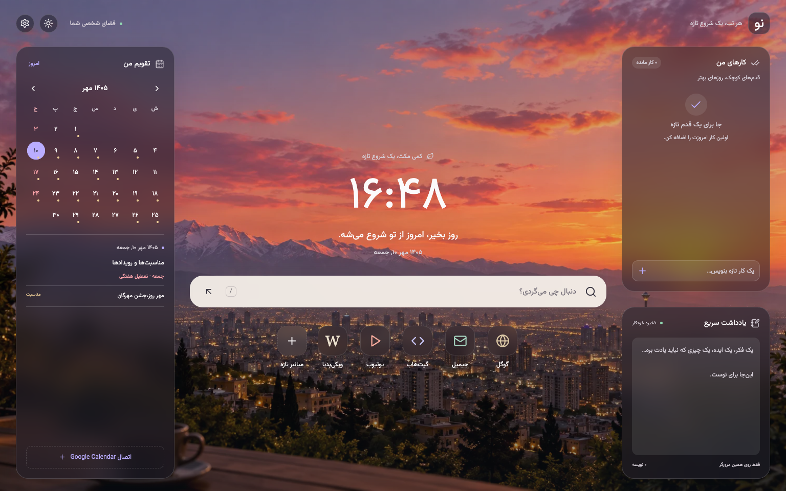

# نو — هر تب، یک شروع تازه

افزونه New Tab فارسی و RTL برای Chrome، Edge و Firefox دسکتاپ ۱۴۰ به بالا، با React + TypeScript + Vite و Manifest V3. اسکفولد مستقل با مجوز MIT؛ فورک Tabset نیست.

## نصب نسخه آماده

۱. فایل `no-extension.zip` را از حالت فشرده خارج کنید.
۲. در Chrome صفحه `chrome://extensions` یا در Edge صفحه `edge://extensions` را باز کنید.
۳. Developer mode را روشن کنید و روی Load unpacked بزنید.
۴. پوشه‌ای را انتخاب کنید که فایل `manifest.json` داخل آن است.
۵. یک تب تازه باز کنید؛ در صورت نمایش پیام مرورگر، تغییر صفحه تب تازه را تأیید کنید.

در مخزن سورس، پوشه `dist` پس از اجرای `bun run build` ساخته می‌شود و در Git نگهداری نمی‌شود. نصب محلی به‌روزرسانی دستی دارد.

## نصب نسخه Firefox

فایل `no-firefox.zip` را استخراج کنید. در Firefox صفحه `about:debugging#/runtime/this-firefox` را باز کنید، روی **Load Temporary Add-on** بزنید و فایل `manifest.json` داخل پوشه استخراج‌شده را انتخاب کنید. یک تب تازه باز کنید و در صورت درخواست مرورگر، تغییر صفحه تب تازه را تأیید کنید. حداقل نسخه Firefox دسکتاپ: ۱۴۰.

این بسته امضای Mozilla ندارد؛ نصب موقت با بستن و باز کردن Firefox حذف می‌شود. برای نصب دائمی در Firefox معمولی، بسته باید در Mozilla Add-ons امضا شود. ZIP فعلی برای تست موقت و ارسال جهت امضا مناسب است؛ نسخه فروشگاهی نیست.

نسخه Firefox علاوه بر تب تازه، صفحه خانگی و پنجره‌های تازه را هم به نو تغییر می‌دهد؛ در صورت نمایش پیام مرورگر، این تغییر را تأیید کنید. برای دیدن نو هنگام شروع مرورگر، گزینه بازگردانی پنجره‌ها و تب‌های قبلی را در تنظیمات Firefox خاموش کنید و صفحه خانگی را روی نو نگه دارید. انتخاب صفحه خالی یا بازگردانی نشست قبلی همچنان مطابق تنظیمات مرورگر عمل می‌کند. با نصب موقت، پس از بستن Firefox افزونه حذف می‌شود و برای استفاده دوباره باید آن را بارگذاری کنید.

داده‌های محلی نصب موقت را دائمی فرض نکنید؛ قبل از حذف یا ری‌استارت، از تنظیمات پشتیبان بگیرید. نسخه Firefox شناسه ثابت افزونه دارد و عبارت‌های جست‌وجو را در اعلان داده‌های Firefox اعلام می‌کند؛ فقط جست‌وجویی که خودتان ارسال می‌کنید به موتور انتخاب‌شده می‌رود. یادداشت و Todo ارسال نمی‌شوند.

مستندات: [صفحه تب تازه](https://developer.mozilla.org/en-US/docs/Mozilla/Add-ons/WebExtensions/manifest.json/chrome_url_overrides)، [اعلان داده‌ها](https://extensionworkshop.com/documentation/develop/firefox-builtin-data-consent/)، [امضا و توزیع](https://extensionworkshop.com/documentation/publish/signing-and-distribution-overview/).

## قابلیت‌ها

ساعت محلی و تاریخ شمسی، تقویم ماهانه با رفتن به ماه قبل/بعد و امروز، رویدادهای Google Calendar با اتصال خصوصی iCal، Google/Bing/DuckDuckGo، افزودن/ویرایش/حذف میانبر، کارها با تیک و حذف، یادداشت با ذخیره خودکار، تم روشن/تیره/سیستم، سه پس‌زمینه، خروجی و بازیابی JSON، پشتیبانی صفحه کوچک و میانبر `/` برای جست‌وجو. نوار پایین حذف شده و چیدمان دسکتاپ با ارتفاع پنجره هماهنگ می‌شود؛ لیست‌های بلند درون پنل خودشان اسکرول دارند.

تقویم از `Intl` با تقویم Persian و زمان محلی دستگاه استفاده می‌کند. مناسبت‌های ایرانی و تعطیلات رسمی ۱۴۰۵ داخل بسته هستند. ساخت/ویرایش رویداد، آب‌وهوا و همگام‌سازی ابری در این نسخه وجود ندارد.

## مناسبت‌ها و تعطیلات ایران

مناسبت‌ها بدون اینترنت نمایش داده می‌شوند. تعطیلات رسمی و جمعه‌ها قرمزند؛ مناسبت‌ها نقطه طلایی دارند و رویدادهای Google نقطه دیگری. روی روز بزنید تا مناسبت‌ها و رویدادها را با هم ببینید.

۲۲۱ مناسبت برای ۱۴۰۵ در بسته قرار دارد. تاریخ مناسبت‌های قمری و فهرست ۲۶ روز تعطیل رسمی یکتا با تقویم رسمی سال ۱۴۰۵ مرکز تقویم مؤسسه ژئوفیزیک دانشگاه تهران تطبیق داده شده‌اند. در سال‌های دیگر فقط مناسبت‌های ثابت خورشیدی نمایش داده می‌شوند و هشدار پوشش ناقص تاریخ‌های قمری دیده می‌شود؛ تاریخ قمریِ سال تأییدنشده تخمین زده نمی‌شود. این داده‌ها برای تعطیلی اضطراری یا اداریِ موردی نیستند.

منبع پایه داده‌ها: [pipe2time.ir](https://github.com/HMarzban/pipe2time.ir)، MIT. snapshot پایه تاریخی بود؛ تاریخ‌های قمری ۱۴۰۵ مطابق سند رسمی اصلاح شده‌اند. [سند رسمی دانشگاه تهران](https://calendar.ut.ac.ir/documents/2139738/7092644/Calendar-1405.pdf)، [نسخه آینه سند](https://www.scribd.com/document/990789768/Calendar-1405). جزئیات اصلاح‌ها در IRAN_CALENDAR_DATA.md است.

## پس‌زمینه شخصی و متحرک

در تنظیمات، زیر پس‌زمینه‌ها، فایل خود را آپلود کنید. JPG، PNG، WebP، GIF و AVIF تا ۲۰ مگابایت؛ MP4، WebM و OGG تا ۸۰ مگابایت. پشتیبانی واقعی ویدئو به کدک مرورگر بستگی دارد؛ فایل ناسازگار قبل از ذخیره رد می‌شود. GIF با تصویر معمولی نمایش داده می‌شود و متحرک می‌ماند. ویدئو خودکار و تکرارشونده پخش می‌شود؛ muted و volume=0 همیشه اعمال می‌شوند. وقتی تب مخفی است ویدئو متوقف و با بازگشت تب ادامه پیدا می‌کند.

فایل در IndexedDB همین مرورگر ذخیره می‌شود؛ به هیچ سروری آپلود نمی‌شود. پس از بستن و باز کردن تب باقی می‌ماند. انتخاب یکی از پس‌زمینه‌های آماده، فایل شخصی را پاک نمی‌کند؛ می‌توانید با دکمه استفاده دوباره فعالش کنید. دکمه حذف فقط فایل شخصی را حذف می‌کند. یک فایل شخصی در هر زمان نگه داشته می‌شود و آپلود بعدی جایگزین آن است. فایل‌های رسانه‌ای در پشتیبان JSON نیستند؛ فایل اصلی را نگه دارید.

## آیکون میانبرها

هنگام افزودن یا ویرایش میانبر می‌توانید یکی از نمادهای آماده را انتخاب کنید یا لوگوی PNG، JPG، WebP یا ICO تا ۱ مگابایت بارگذاری کنید. لوگو به PNG کوچک تبدیل می‌شود و همراه میانبر در همین مرورگر و پشتیبان JSON نگهداری می‌شود؛ پشتیبان‌های قدیمی همچنان قابل بازیابی هستند.

میانبرهای پیش‌فرض گوگل، جیمیل، گیت‌هاب، یوتیوب و ویکی‌پدیا نمادهای اصلی خود را نگه می‌دارند؛ انتخاب نماد یا لوگوی دلخواه همچنان ممکن است. برای میانبرهایی که خودتان اضافه می‌کنید، اگر آیکون انتخاب نکنید، مرورگر تصویر `/favicon.ico` را مستقیماً از مبدأ سایت دریافت می‌کند؛ مسیر صفحه، query و اطلاعات ورود موجود در آدرس به URL آیکون منتقل نمی‌شوند و referrer ارسال نمی‌شود. سرویس واسطی استفاده نمی‌شود؛ این درخواست، IP و اطلاعات معمول درخواست مرورگر را برای سایت مقصد قابل مشاهده می‌کند. دریافت آیکون تابع سیاست‌های حریم خصوصی و کش مرورگر است. سایت‌هایی که آیکون را در مسیر دیگری دارند، دریافت را مسدود می‌کنند یا در حالت آفلاین در کش نیستند، با نماد پیوند نمایش داده می‌شوند. نمادهای آماده و لوگوهای بارگذاری‌شده آفلاین کار می‌کنند و برای آیکون از سایت درخواست نمی‌فرستند.

## اتصال Google Calendar

در تنظیمات نو، بخش Google Calendar را باز کنید. در [تنظیمات Google Calendar](https://calendar.google.com/calendar/u/0/r/settings)، تقویم موردنظر را انتخاب کنید و در Integrate calendar، لینک **Secret address in iCal format** را کپی کنید. آن را همراه نام تقویم در نو وارد کنید، روی اتصال تقویم بزنید و دسترسی مرورگر را تأیید کنید. [راهنمای رسمی Google](https://support.google.com/calendar/answer/37648?hl=en).

نیازی به عمومی کردن تقویم، حساب توسعه‌دهنده یا OAuth Client ID نیست. از لینک صفحه یا Embed استفاده نکنید. تا ۱۰ تقویم قابل اتصال است. تقویم‌های سازمانی ممکن است لینک خصوصی iCal نداشته باشند؛ این نسخه ورود مستقیم OAuth ندارد.

روزهای دارای رویداد با نقطه مشخص می‌شوند. روی روز بزنید تا رویدادهای آن روز را ببینید؛ رویدادهای تکراری، استثناها، تمام‌روز و چندروزه پشتیبانی می‌شوند. زمان رویدادها مطابق منطقه زمانی دستگاه نمایش داده می‌شود. تقویم هنگام بازشدن تب و هر ۱۵ دقیقه تا زمان بازماندن آن دریافت می‌شود؛ دکمه به‌روزرسانی هم موجود است. ممکن است Google تغییرات را در feed با تأخیر منتشر کند.

این اتصال فقط خواندنی است. لینک خصوصی امکان خواندن تقویم را فراهم می‌کند؛ آن را محرمانه نگه دارید. لینک فقط در localStorage مرورگر ذخیره می‌شود و در نسخه پشتیبان قرار نمی‌گیرد. رویدادهای دریافت‌شده فقط در حافظه تب نگهداری می‌شوند. قطع آخرین اتصال، اجازه دسترسی را نیز حذف می‌کند. برای لغو کامل اعتبار لینک، در Google Calendar آن را Reset کنید.

## توسعه

Node.js 22+ و Bun 1.3.8؛ برای ساخت قابل تکرار از lockfile موجود استفاده کنید:

```sh
bun install --frozen-lockfile
bun run dev
bun run build
bun run build:firefox
bun test
bun run check
```

برای npm می‌توان `npm install`، `npm run dev` و `npm run build` را استفاده کرد. تست تقویم با Bun اجرا می‌شود. پس از تغییر سورس و build، افزونه را در صفحه مدیریت افزونه‌ها Reload کنید.

`build` خروجی Chrome/Edge را در `dist` می‌سازد؛ `build:firefox` خروجی مستقل Firefox را در `dist-firefox` با manifest مخصوص آن تولید می‌کند.

## حریم خصوصی

هیچ تبلیغ، تحلیل‌گر، حساب جداگانه نو یا کد خارجی وجود ندارد. داده‌های شخصی رابط در localStorage صفحه افزونه نگه‌داری می‌شوند و بین تب‌های باز به‌روز می‌شوند. پاک‌کردن داده‌های افزونه یا حذف آن می‌تواند داده‌ها را پاک کند؛ از تنظیمات نسخه پشتیبان بگیرید. داده‌های پشتیبان رمزگذاری نشده‌اند. جست‌وجو و میانبرها شما را به سایت مربوط می‌برند و تابع سیاست آن سایت‌اند. اتصال اختیاری تقویم فقط اجازه دسترسی به calendar.google.com را می‌خواهد و پس از تأیید، feed را مستقیم از Google دریافت می‌کند؛ هیچ پراکسی یا سرور واسطی وجود ندارد. دسترسی به تاریخچه مرورگر درخواست نمی‌شود.

## منابع و مجوز

- کد پروژه: MIT، فایل LICENSE.
- React / React DOM / Vite / TypeScript / Lucide: متن مجوزهای وابستگی‌ها در THIRD_PARTY_NOTICES.txt.
- ical.js 2.2.1: MPL-2.0؛ نسخه بدون تغییر سورس و مجوز در public/vendor/ical.js قرار دارد و همراه هر دو بسته توزیع می‌شود. مجوز کد خود نو MIT است.
- مجموعه داده پایه مناسبت‌های ایرانی: MIT، مجوز در public/vendor/iran-events/LICENSE.
- Vazirmatn: بسته محلی، [منبع رسمی](https://github.com/rastikerdar/vazirmatn)، SIL OFL 1.1، فایل public/fonts/OFL.txt.
- سیاست امنیتی Manifest V3 مطابق [مستندات Chrome](https://developer.chrome.com/docs/extensions/reference/manifest/content-security-policy)؛ تمام کد و فونت‌ها در بسته‌اند.

برای جزئیات بررسی‌ها فایل TESTING.md را ببینید.

## همکاری در توسعه

این مخزن برای همکاری محلی آماده شده و هنوز روی GitHub منتشر نشده است. راهنمای راه‌اندازی، ساختار کد و ارسال تغییرات در [CONTRIBUTING.md](CONTRIBUTING.md) است. کارهای پیشنهادی را در [ROADMAP.md](ROADMAP.md) ببینید؛ روند انتشار در [RELEASING.md](RELEASING.md) و گزارش خصوصی مشکلات امنیتی در [SECURITY.md](SECURITY.md) آمده است.

قالب گزارش باگ و درخواست قابلیت، قالب pull request و بررسی خودکار تست/بیلد برای انتشار احتمالی بعدی آماده‌اند. pull requestها فقط بررسی می‌شوند؛ هر تغییر موفق روی main هر دو بسته مرورگر را در بخش GitHub Releases به‌صورت نسخه آزمایشی منتشر می‌کند. بسته Firefox در این بخش امضانشده است؛ انتشار و امضای فروشگاهی جدا انجام می‌شود. اطلاعات حساب فروشگاه، لینک خصوصی تقویم، رویداد واقعی، یادداشت شخصی و فایل پشتیبان را وارد Git نکنید.


